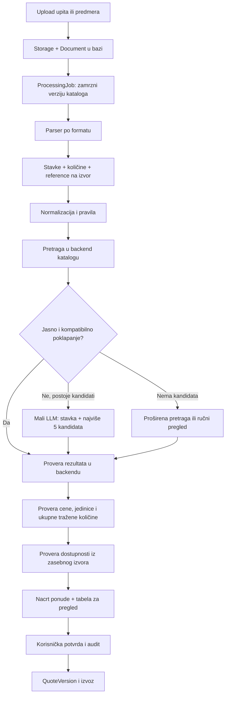

# Plan obrade dokumenata i povezivanja sa katalogom

Datum: 27.10.2026. Status: predlog za implementaciju, bez promena aplikacije.

## 1. Cilj i osnovna odluka

Iz učitanog upita/predmera izvući stavke, pronaći proizvode u katalogu organizacije i vratiti tabelu koju korisnik može da proveri uz originalni dokument. Posebno prikazati nejasno poklapanje, nedostajuću cenu i nedovoljnu ili nepoznatu zalihu.

**Backend parsira, pretražuje, proverava i računa. Mali LLM pomaže u tumačenju samo kada pravila nisu dovoljna.** Model ne dobija ceo katalog, ne generiše SQL, ne utvrđuje stanje magacina i ne odobrava ponudu.

Prva verzija pokriva Product Quoting, pre svega CSV/XLSX. Technical Quoting koristi isti okvir za izdvajanje stavki, ali rad, usluge i složene pozicije zahtevaju poseban matching i cenovnik; ne svoditi ih automatski na jedan proizvod.

## 2. Polazno stanje u repozitorijumu

| Oblast | Trenutno stanje | Potrebno za ovaj tok |
| --- | --- | --- |
| Upload upita/predmera | Original i JSON metapodaci na lokalnom disku | Upis `Document` u bazu i povezivanje sa storage-om |
| Katalog | CSV/XLSX import, mapiranje kolona, validacija, verzije, `ProductAlias` | Pretraga kandidata, normalizovani atributi, indeksi |
| Pretraga kataloga | `ILIKE` nad nazivom/SKU; vraća do 3.000 artikala | Poseban servis koji vraća samo najbolje kandidate |
| Obrada i ponude | Modeli postoje; process, positions, jobs i quote rute su placeholder-i | Worker, API ugovori i ekran pregleda |
| Zalihe | Nema modela količine, rezervacije ni izvora stanja | Poseban izvor i model dostupnosti |
| Organizacija | Katalog koristi server-side lokalnu organizaciju | Jedinstven organizacioni kontekst kroz ceo tok |

Relevantni fajlovi: `services/api/app/models/entities.py`, `app/core/enums.py`, `app/documents/storage.py`, `app/catalog/service.py`, `app/catalog/importer.py` i `app/api/v1/endpoints/`, relativno prema `services/api/` za putanje koje počinju sa `app/`.

Postojeći katalog predstavlja proizvode i cene. **Iz njega se ne može zaključiti da proizvod postoji na stanju.** Nijedan predloženi servis, status ili novo polje u nastavku još nije implementiran.

## 3. Tok obrade



Obradu pokretati eksplicitnim zahtevom. `POST /documents/{id}/process` treba da vrati `202` i `job_id`; FE prati posao i učitava rezultate. Upload kataloga i upload korisničkog upita ostaju različite operacije: katalog je izvor proizvoda, upit je izvor traženih stavki.

### 3.1. Čitanje fajla bez LLM-a kada je moguće

| Format | Prvi korak | Kada koristiti model |
| --- | --- | --- |
| CSV/XLSX | Parser, mapiranje kolona, opis, količina, jedinica i šifra | Neobična zaglavlja ili opis koji pravila ne razumeju |
| Tekstualni PDF | Izdvajanje teksta/tabela po strani uz očuvanje rasporeda | Rekonstrukcija nejasnog bloka u stavke |
| Skenirani PDF | OCR samo potrebnih strana; označiti nečitke delove | Ograničeni vizuelni poziv kao kasniji fallback |
| EML | MIME parser, telo poruke i prilozi; ukloniti potpis i citiranu prepisku kada je prepoznatljiva | Pretvaranje relevantnog slobodnog teksta u stavke |

Za XLSX prvo predložiti mapiranje iz zaglavlja. Ako je mapiranje nejasno, poslati modelu samo zaglavlja i do 5 reprezentativnih redova, pa ponuditi korisniku potvrdu. Ne izvršavati formule ili makroe; odsutnu keširanu vrednost označiti za proveru.

Svaka stavka čuva `raw_description`, originalnu količinu/jedinicu i `source_ref`: sheet/red/ćelije ili stranu i okvir teksta. Za PDF predložiti proširenje reference sa koordinatama, za EML sa delom poruke/prilogom. Ne pretvarati praznu ili nečitku količinu u nulu.

Kod slobodnog teksta jedinica LLM ekstrakcije je smislen blok ili sekcija. Sačuvati naslov sekcije, legendu jedinica i povezane redove, jer mogu menjati značenje stavke. Zbirne redove i zaglavlja ne pretvarati u proizvode. Parser treba da evidentira koji redovi su obrađeni, preskočeni ili ostavljeni za proveru, da stavke ne nestanu neprimetno.

### 3.2. Normalizacija koja čuva specifikaciju

Sačuvati original, a zasebno pripremiti tekst za pretragu: razmaci, mala slova, decimalni zarez/tačka u brojčanim poljima i dogovoreni sinonimi jedinica. Primer: `3 × 2,5 mm²` i `3x2.5 mm2` mogu dati iste strukturirane atribute.

Ne izjednačavati `3x1.5` i `3x2.5`, B16 i C16, 1P i 3P, 230 V i 400 V, ili metar i pakovanje. Skidanje dijakritike i transliteracija mogu pomoći tekstualnoj pretrazi, ali ne smeju proizvoljno menjati identifikatore.

Za demo elektro-katalog izvoditi kategoriju, broj provodnika, presek, nazivnu struju, karakteristiku osigurača i broj polova. Prvo koristiti pravila; model samo za nejasne opise. Svaki atribut mora imati dokaz iz teksta ili biti `null`. Nepoznat atribut nije dokaz kompatibilnosti.

### 3.3. Pretraga kandidata pre modela

Svaki upit filtrirati po `organization_id`, zamrznutom `catalog_import_id` i aktivnom proizvodu. Koristiti parametrizovane upite.

Redosled pretrage:

1. Tačan SKU, uz konzervativnu normalizaciju. Proveriti da opis ne sadrži protivrečnu specifikaciju.
2. Tačan, prethodno potvrđen alias. Alias koji vodi na više artikala znači dvosmislenost.
3. Naziv i tokeni, zatim trigram sličnost preko PostgreSQL `pg_trgm`, uz filtriranje po kategoriji i strukturiranim atributima.
4. Samo ako prethodno nije dovoljno, jedno proširenje upita iz izdvojenih atributa ili kratkog LLM predloga ključnih reči. Bez petlje autonomnog pretraživanja.
5. Embedding pretraga ostaje opcija tek ako merenja pokažu da leksička pretraga propušta važne kandidate. Ako se uvede, vektore kataloga izračunati jednom po verziji, uz istu proveru tehničkih ograničenja.

Backend može interno rangirati do 20 kandidata, ali model dobija najviše 5. Nepoklapanje obaveznog atributa isključuje kandidata iz tačnog poklapanja bez obzira na sličan naziv. Nepotpune specifikacije vode u pregled. Moguću zamenu prikazati odvojeno kao alternativu kojoj je potrebna potvrda.

`UNMATCHED` znači „nije pronađeno u pregledanoj verziji kataloga“, a ne „taj proizvod sigurno ne postoji u firmi“. Odsutan ili neispravan katalog daje `CATALOG_UNAVAILABLE`, ne masovno `UNMATCHED`. Nijedan od tih ishoda ne znači da je stanje zalihe nula.

## 4. Uloga malog LLM-a i granice konteksta

Koristiti jedan mali model koji pouzdano vraća strukturirani JSON i prolazi naš skup testova. Konkretan provider/model izabrati poređenjem kvaliteta, latencije i potrošnje na istim primerima; ne birati unapred po veličini ili reklamnom opisu. Ne uvoditi fine-tuning ili agent framework za MVP.

Model ima dve uske uloge, sa zasebnim ugovorima:

- Ekstrakcija: iz malog bloka izvući stavke i atribute, sa dokazima i eksplicitnim nepoznatim poljima.
- Razrešavanje kandidata: iz ponuđenih kandidata izabrati jednog ili vratiti da podaci nisu dovoljni. Ne sme izmisliti novi proizvod.

Za jasno strukturiran CSV/XLSX sa tačnim SKU-ovima ceo dokument može proći bez LLM poziva. Za nejasan slobodan tekst prvo završiti ekstrakciju, zatim izvršiti pretragu; model za ekstrakciju ne dobija katalog.

### Primer ulaza za razrešavanje kandidata

```json
{
  "line_id": "L-12",
  "request": {
    "description": "PP-Y 3 x 2,5 mm2",
    "unit": "m",
    "attributes": {"cores": 3, "section_mm2": "2.5"}
  },
  "candidates": [
    {"id": "c1", "sku": "CAB-3X25", "name": "Kabl PP-Y 3x2.5 mm2", "unit": "m"},
    {"id": "c2", "sku": "CAB-5X25", "name": "Kabl PP-Y 5x2.5 mm2", "unit": "m"}
  ]
}
```

Ovaj primer ilustruje ugovor; ako pravila već potvrđuju prvi artikal i isključuju drugi, model se uopšte ne poziva. Kratki ID-jevi važe samo unutar poziva i backend ih mapira na stvarne UUID-jeve.

### Primer očekivanog izlaza

```json
{
  "line_id": "L-12",
  "selected_candidate_id": "c1",
  "decision": "MATCH",
  "reason_codes": ["CORE_COUNT_MATCH", "SECTION_MATCH"],
  "missing_attributes": []
}
```

Dozvoliti `MATCH`, `AMBIGUOUS` i `NO_MATCH`, sa `selected_candidate_id: null` kada nema izbora. Validirati JSON/Pydantic šemom, odbiti nepoznate ID-jeve, duplirane ili izostavljene stavke i ponovo proveriti tehničke uslove. Modelov izbor ne menja backend činjenice.

Ne slati modelu cene, zalihe, organizacione podatke ili kompletnu prepisku ako nisu potrebni za prepoznavanje. Model ne treba da vrati samoprocenjeni procenat tačnosti niti dugačko rezonovanje; dovoljni su kratki kodovi razloga i nedostajući atributi.

### Početni budžeti, za podešavanje merenjem

| Operacija | Predloženi limit |
| --- | --- |
| Predlog mapiranja | Jedan poziv po novom layout-u; zaglavlja + do 5 redova |
| Ekstrakcija bloka | Do 2.500 ulaznih i 1.200 izlaznih tokena |
| Matching jedne stavke | Cilj do 1.500 ulaznih i 200 izlaznih tokena |
| Grupni matching | Do 5 kratkih, nezavisnih stavki i ukupno 4.000 ulaznih / 800 izlaznih tokena |
| Kandidati | Najviše 5 po stavci |
| Retry | Najviše jedan za prolaznu grešku ili nevalidan odgovor, unutar istog budžeta |
| Jači model | Isključen podrazumevano; kasnije samo ciljane stavke i poseban limit |

Token-limit uključuje instrukcije, šemu odgovora, lokalni kontekst i kandidate. Broj redova nije zamena za merenje tokena. Ako blok ne staje, deliti po logičnim granicama uz reference i kontrolu pokrivenosti; ne odseći tekst ili prihvatiti prekinut JSON. Pojedinačno preduga ili složena stavka ide na ručni pregled.

Server podešava maksimalni token-budžet po poslu, npr. početno 30.000 ukupnih ulaznih i izlaznih tokena. Pre svakog poziva rezervisati gornju granicu i računati retry-je. Kada se limit dostigne, sačuvati završene rezultate, preostale označiti `BUDGET_EXCEEDED` i ponuditi nastavak/ručni pregled. Ne tvrditi da je ceo fajl obrađen.

## 5. Procena pouzdanosti i tabela za proveru

Odvojiti četiri dimenzije: pouzdanost izdvajanja iz dokumenta, poklapanje proizvoda, dostupnost i stanje cene. Jedan `review_status` nije dovoljan da ih sve predstavi.

### Ocena poklapanja

Za MVP prikazivati **visoka / srednja / niska / nema procene**, uz konkretne razloge. Trigram rezultat i broj koji model navede nisu verovatnoća tačnog odgovora.

- **Visoka:** jedinstven tačan SKU ili potvrđen jedinstven alias, kompatibilni obavezni atributi i jedinica, bez protivrečnosti u izvoru.
- **Srednja:** kandidat izgleda odgovarajuće, ali je izabran približnom pretragom/modelom ili nedostaje važan atribut. Korisnik potvrđuje.
- **Niska:** više mogućnosti, mala razlika između kandidata, nečitak izvor ili nepotpuna specifikacija. Ne birati automatski.
- **Nema procene:** obrada nije uspela, katalog nije dostupan ili nema kandidata.

Backend čuva način pretrage, sličnost, razliku između prva dva kandidata, poklopljene/konfliktne/nepoznate atribute, verziju pravila i razlog odluke. Pragove približnog poklapanja podesiti na označenom skupu, a ne proglasiti proizvoljnih 0,90 za „90% tačno“.

Procenat u UI uvesti tek kada postoji dovoljno nezavisno označenih primera i validirana kalibracija na odvojenom test skupu. Tada se procenjuje verovatnoća tačnosti identiteta proizvoda, uz praćenje kalibracije; procenat ne obuhvata automatski tačnost količine, cene i zalihe.

### Predlog korisničke tabele

Brojevi zaliha u ovoj tabeli su izmišljeni primeri ponašanja, nisu podaci iz sadašnjeg backend-a.

| Izvorna stavka | Traženo | Predlog iz kataloga | Poklapanje | Pouzdanost | Raspoloživo | Dostupnost | Sledeća radnja |
| --- | --- | --- | --- | --- | --- | --- | --- |
| CAB-3X25, PP-Y 3x2.5 | 200 m | CAB-3X25 | Tačan SKU | Visoka | 120 m | Nedostaje 80 m | Potvrdi artikal i proveri nabavku |
| Automatski osigurač 16 A | 30 kom | B16 1P / C16 1P | Dvosmisleno | Niska | — | Nije provereno | Odredi karakteristiku i broj polova |
| UTP Cat6 | 150 m | CAB-UTP6 | Predlog | Srednja | — | Stanje nepoznato | Potvrdi artikal i pribavi stanje |
| Artikal bez kandidata | 10 kom | — | Nije pronađeno u katalogu | Nema procene | — | Nije provereno | Ručna pretraga |

Klik na stavku otvara izvorni red/stranu i detalje: original naspram izdvojenih vrednosti, razloge, alternativne proizvode, cenu/valutu i vremensku oznaku zalihe. Korisnik može da izabere drugi proizvod, ispravi količinu/jedinicu ili označi da dodatni podaci nisu dostupni.

Čuvati predložene vrednosti odvojeno od `approved_*`. Visoka pouzdanost ne odobrava ponudu. `MISSING_PRICE`, neispravna količina i nerešena stavka ostaju vidljive i kada je identitet proizvoda siguran.

## 6. Dostupnost i količine

Uvesti podatke o stanju iz ručnog demo unosa/uvoza, a kasnije ERP-a. Zaliha se nikada ne popunjava LLM procenom.

Predlog `InventoryBalance`: `organization_id`, stabilni identitet artikla, `warehouse_id`, `on_hand`, `reserved`, `unit`, `observed_at` i `source`. Potrebno je definisati jedinstvenost po artiklu i magacinu, dozvoljene magacine i maksimalnu starost podataka; prag svežine je konfiguracija izvora, ne univerzalna pretpostavka.

`Product.id` se menja između verzija kataloga. Zato zalihe ne vezivati trajno samo za taj ID: za MVP koristiti `(organization_id, sku)` uz eksplicitno pravilo da SKU ostaje stabilan između uvoza. Ako to ne važi za izvor, dodati stabilni `CatalogItem` ili mapiranje na ERP identifikator.

Pravila:

- `available = max(on_hand - reserved, 0)`; nekonzistentne vrednosti dodatno označiti.
- Sabirati tražene količine svih stavki istog artikla i kompatibilne jedinice u nacrtu. Dva reda od po 80 m zahtevaju ukupno 160 m; stanje od 120 m nije dovoljno za oba.
- Bez proverenog faktora konverzije ne pretvarati pakovanje u komade ili kotur u metre. Sačuvati faktor i izvor konverzije kada postoje.
- `SUFFICIENT`: sveže stanje pokriva ukupnu traženu količinu.
- `INSUFFICIENT`: sveže stanje je pozitivno, ali manje od traženog; prikazati razliku.
- `OUT_OF_STOCK`: potvrđeno sveže raspoloživo stanje je nula.
- `UNKNOWN`: nema pouzdanog izvora, podaci su zastareli ili jedinice nisu uporedive. `NOT_CHECKED`: artikal još nije izabran/provera nije pokrenuta.

Provera ne rezerviše robu i ne garantuje buduću isporuku. Ponovo proveriti stanje pred odobravanje i sačuvati tadašnji snapshot; ako se kasnije uvedu rezervacije, rešavati ih transakciono u inventory/ERP servisu. U MVP-u ne potvrđivati automatski isporučivost kada je stanje nepoznato ili nedovoljno: korisnik mora da reši problem ili eksplicitno odobri ponudu uz zabeležen uslov nabavke.

## 7. Predložene promene modela

| Entitet | Predlog |
| --- | --- |
| `Product` | Normalizovani naziv/SKU, strukturirani tehnički atributi, verzija normalizacije; indeksi za pretragu |
| `ProductAlias` | Normalizovani alias, poreklo/potvrda; više pogodaka je moguće i mora biti vidljivo |
| `ExtractedPosition` | Normalizovan opis/jedinica, izdvojeni atributi i dokazi, extraction status, verzija parsera/modela |
| `MatchCandidate` | Zadržati `rank`; u `evidence` čuvati metod, sličnosti, uslove i razloge; dodati vezu sa konkretnim prolazom obrade |
| Novi `PositionMatchResult` | Rezultat i za stavku bez kandidata: position/run ID, nullable predloženi product ID, match status, nivo pouzdanosti i razlozi |
| `QuoteLine` | Odvojene predložene i potvrđene vrednosti; dostupnost i provera cene ne smeju zavisiti samo od `review_status` |
| Novi `InventoryBalance` | Stanje po stabilnom artiklu/magacinu, jedinica, izvor i vreme posmatranja |
| `ProcessingJob` | Faza, napredak, zamrznuti katalog/cenovnik, verzije parsera/prompta/pravila/modela, budžet i potrošnja |
| Novi zapis prolaza obrade | `run_id`, idempotency ključ, pokušaji, rezultati po stavci i otkazivanje/završetak |
| `QuoteVersion` | Snapshot odobrenih stavki, izvora cena, uslova nabavke i provere zaliha |

Nove statuse i polja dodati migracijama i Pydantic ugovorima; ne tretirati ih kao postojeće enum vrednosti. `MatchCandidate.evidence` može služiti za detalje u MVP-u, ali odsustvo kandidata zahteva zaseban rezultat, ne lažni proizvod.

Zamrznuti katalog na početku posla i koristiti isti snapshot tokom svih faza. Ponovna obrada novim katalogom kreira novi prolaz; ne prepisuje korisničke potvrde. Početni idempotency ključ: organizacija + dokument + workflow + katalog/cenovnik + verzija pipeline-a + parametri obrade. Posao preuzimati atomarno uz lease/oporavak posle pada; upis rezultata zaštititi od duplikata pri retry-ju. Završetak/partial rezultat i job grešku odvojiti od statusa dokumenta `NEEDS_REVIEW`.

## 8. Cache i potrošnja tokena

- Ponovljene opise normalizovati i grupisati samo kada su svi semantički atributi i kontekst isti. Povezivanje sa izvorom i količina ostaju zasebni po redu.
- Extraction cache: organizacija + hash sadržaja/bloka + relevantni naslovi/jedinice + verzija parsera/modela/prompta. Ne uključuje izbor proizvoda.
- Matching cache: organizacija + katalog/cenovnik + normalizovana stavka i ograničenja + hash skupa kandidata + verzije pretrage/pravila/modela/prompta.
- Količina se može izostaviti iz matching ključa samo ako ne menja specifikaciju/pakovanje. Rezultat provere zaliha se ne preuzima iz matching cache-a.
- Novi katalog poništava prethodni matching cache. Stanje zaliha čitati posebno uz kontrolu svežine.
- Korisnička ispravka može predložiti novi alias, ali ne postaje automatski univerzalno pravilo; sačuvati opseg i odobrenje.
- Beležiti stvarne ulazne/izlazne tokene, cache pogotke, trajanje, retry-je, procenat stavki bez LLM-a i trošak po dokumentu. Cene modela su konfiguracija, ne konstanta u poslovnoj logici.
- Bez istorije razgovora između poziva. Kratke stabilne instrukcije i JSON šema; nema slanja cele ponude radi razrešavanja jednog reda.

Ilustracija: dokument sa 100 redova, od kojih je 75 rešeno pravilima i 10 ponovljenih nejasnih opisa ima postojeći cache, ostavlja 15 novih stavki za model. U grupama do 5 to može biti 3 matching poziva, ako staju u token-limit. To je primer računice, ne izmerena ušteda; ekstrakcija, mapiranje i retry-ji računaju se posebno.

## 9. Backend i API raspodela

Planirani moduli unutar `services/api/app/`:

- `processing/`: DB-backed worker, preuzimanje/lease poslova, faze, budžet i nastavak.
- `documents/parsers/`: CSV/XLSX prvo, PDF/EML potom.
- `matching/`: normalizacija, atributi, retrieval, provera ograničenja i odluka.
- `llm/`: provider adapter, ograničeni JSON ugovori, timeout/retry i evidencija potrošnje.
- `inventory/`: izvor stanja, konverzije, zbir tražnje i snapshot.
- `quotes/`: predlozi, korisnički pregled, odobravanje i verzije.

Za MVP je dovoljan poseban worker proces sa poslovima u PostgreSQL-u; dodatni broker uvoditi kada merenje opterećenja to opravda. Ne obrađivati dokument kroz dug HTTP zahtev niti se oslanjati na memoriju web procesa za trajnost posla.

Iskoristiti postojeće putanje: `/documents/{id}/process`, `/jobs/{id}`, `/documents/{id}/positions`, `/quotes/{id}`, `/quotes/{id}/lines/{line_id}` i `/quotes/{id}/approve`. Rezultat treba da uključuje reference na izvor, predlog i alternative, nivo pouzdanosti, razloge, stanje cene/dostupnosti i vreme provere. Dodati paginaciju; pregled jednog reda ne povlači ceo dokument/katalog.

Patch za ručni pregled mora podržati izbor proizvoda, potvrdu/odbijanje predloga i ispravku količine/jedinice; sadašnji `QuoteLineUpdate` to ne pokriva u celosti. Pre odobravanja backend proverava sve stavke, valutu/cene, jedinice, nerešene zastavice i prihvaćene uslove nabavke, a zatim transakciono upisuje verziju i audit.

## 10. Validacija i izbor modela

Pripremiti početno 100–200 ručno označenih stavki u više dokumenata, koristeći demo katalog i sintetičke zalihe. Deliti skup po dokumentu/layout-u i porodici opisa tako da skoro isti primeri ne budu u razvoju i nezavisnom testu.

Obavezni scenariji: tačan SKU, tipfeler, alias, nepotpun naziv, više kandidata, nepostojeći SKU, SKU u sukobu sa opisom, različiti preseci/polovi, decimalni zarez, pogrešna jedinica, nedostajuća cena, nečitka količina, OCR greška, više redova istog proizvoda, nepoznata/zastarela/nedovoljna zaliha i instrukcija ubačena u sadržaj fajla.

Meriti odvojeno:

- Pokrivenost i tačnost ekstrakcije: da li su pronađene sve stavke, količine, jedinice i izvori.
- Retrieval recall@5: da li se pravi artikal uopšte nalazi među kandidatima. Model ne može izabrati kandidata kojeg retrieval nije našao.
- Precision visokog nivoa pouzdanosti i procenat pogrešno sigurnih rezultata.
- Tačnost predloga, stopu uzdržavanja i potrebnih korisničkih ispravki.
- Ispravnost agregiranja količina, konverzija i dostupnosti, nezavisno od LLM-a.
- Tokene i cenu po dokumentu, udeo cache-a i P50/P95 vreme obrade.

Uporediti pravila/pretragu bez LLM-a sa istim tokom uz 2–3 mala modela. Veći model je opcioni kontrolni eksperiment za teške slučajeve. Izabrati najjeftiniju konfiguraciju koja ispunjava dogovorene kriterijume, ne konfiguraciju koja daje najviše odgovora bez uzdržavanja.

Početni kriterijumi: svi namerni konflikti specifikacije idu na pregled; nijedan izmišljeni ID ne može biti prihvaćen; nepoznata zaliha nikada nije „dovoljno“; svaki red rezultata vodi do izvora; prekid posla i ponavljanje ne dupliraju rezultate. Cilj za precision visokog nivoa je najmanje 99%, ali to nije obećanje pre merenja. Mali skup bez greške ne dokazuje 99% u produkciji; pratiti veličinu uzorka i intervale pouzdanosti.

## 11. Redosled implementacije

1. **Temelj:** `Document` u bazi, organizacioni kontekst, snapshot kataloga, trajni posao i idempotentni upisi. Nema LLM-a.
2. **Deterministički MVP:** CSV/XLSX parser, mapiranje, SKU/alias i atributi, kandidati, nacrt i pregled izvora. Proveriti na demo katalogu.
3. **Pretraga i mali model:** trigram retrieval, ograničeni JSON ugovori, budgets/cache i merenja; model samo za nerešene slučajeve.
4. **Zalihe:** sintetički izvor za demo, stabilni identitet proizvoda, agregirana tražnja, svežina i manjak. Do tada prikazivati `UNKNOWN`.
5. **Odobravanje:** ručne korekcije, audit, zamrznute verzije i izvoz; ponovna provera dostupnosti i eksplicitni uslovi nabavke.
6. **Širenje formata i domena:** PDF/EML, OCR fallback i Technical Quoting sa radom/uslugama; embeddings ili jači model samo uz dokaz da popravljaju merene slabosti.

## 12. Granice poverenja

Tekst dokumenta i nazivi/aliasi u katalogu su podaci, ne instrukcije modelu. Model nema pristup SQL-u, alatima za menjanje stanja ili drugim organizacijama. JSON šema ograničava oblik, ali backend nezavisno proverava ID-jeve, organizaciju, katalog i poslovna pravila. Prompt sam po sebi nije bezbednosna granica.

Za shared/pilot upotrebu potreban je autentifikovan tenant kontekst i server-side autorizacija svih resursa; lokalni `LOCAL_ORGANIZATION_ID` nije tenant izolacija. U LLM slati samo potrebne delove dokumenta, bez nepotrebnih ličnih podataka, a u tehničkim logovima prvenstveno čuvati ID-jeve, verzije, razloge i potrošnju.

## 13. Tehnički izvori

- [PostgreSQL 17: pg_trgm](https://www.postgresql.org/docs/17/pgtrgm.html) — dokumentovana trigram pretraga i GIN/GiST podrška. Predloženi redosled pretrage i pragovi su odluka ovog plana, ne garancija baze.
- [OWASP: LLM Prompt Injection Prevention](https://cheatsheetseries.owasp.org/cheatsheets/LLM_Prompt_Injection_Prevention_Cheat_Sheet.html) — nepoverljivi dokumenti/model output i provere izvan modela.

Budžeti, faze, novi modeli i kriterijumi u ovom dokumentu su početni projektni predlozi. Precizan model, pragovi i performanse potvrđuju se testiranjem na našim dokumentima.
